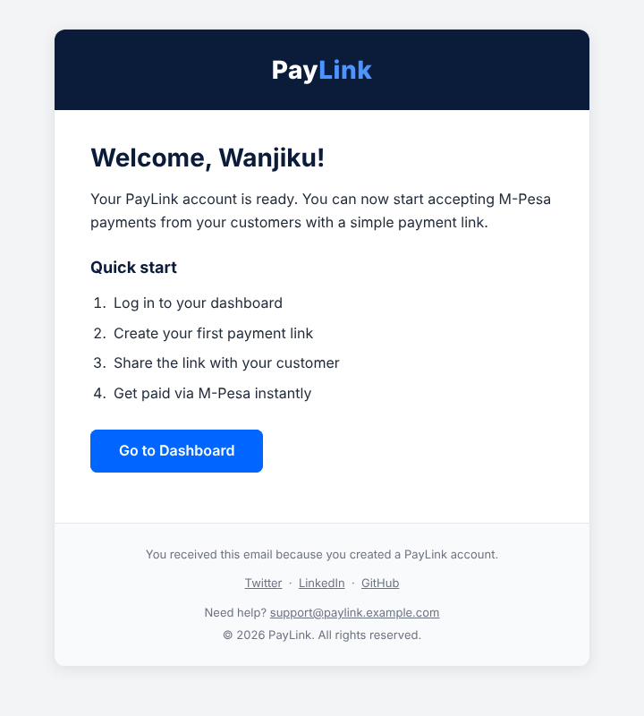
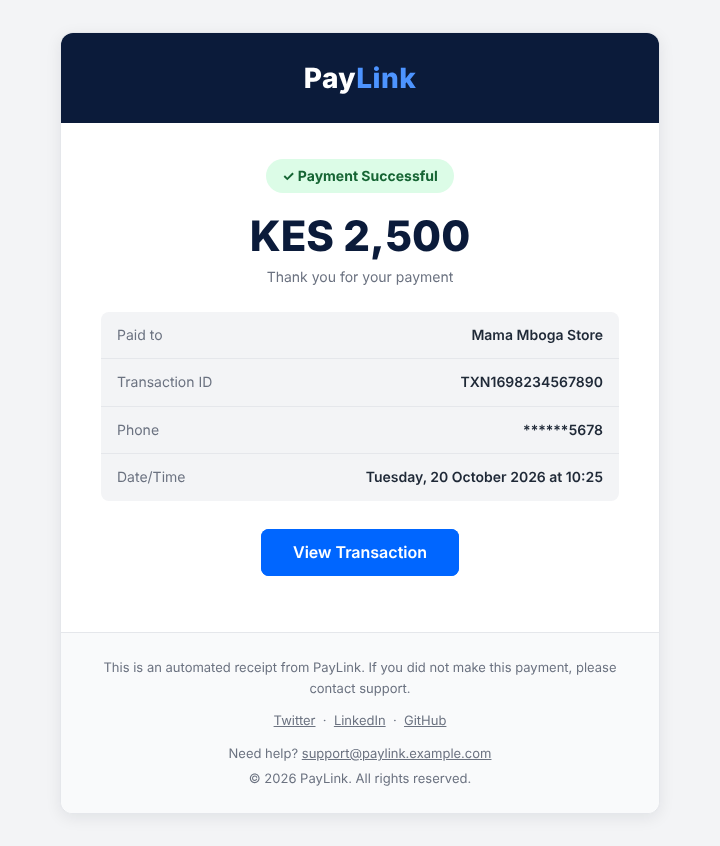
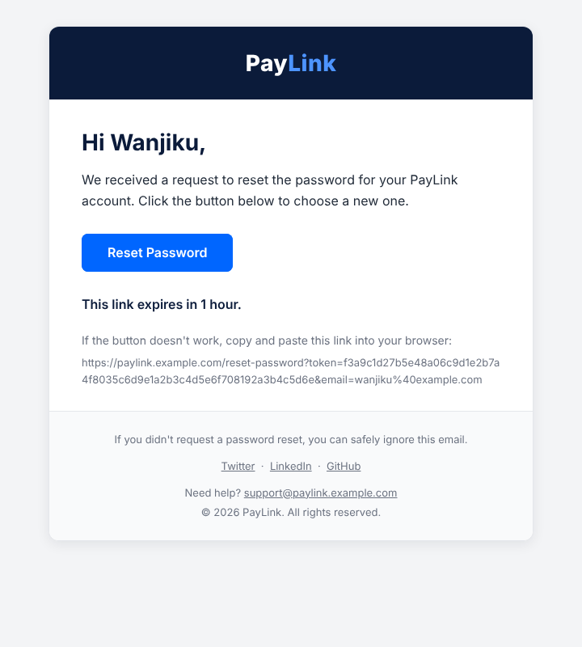
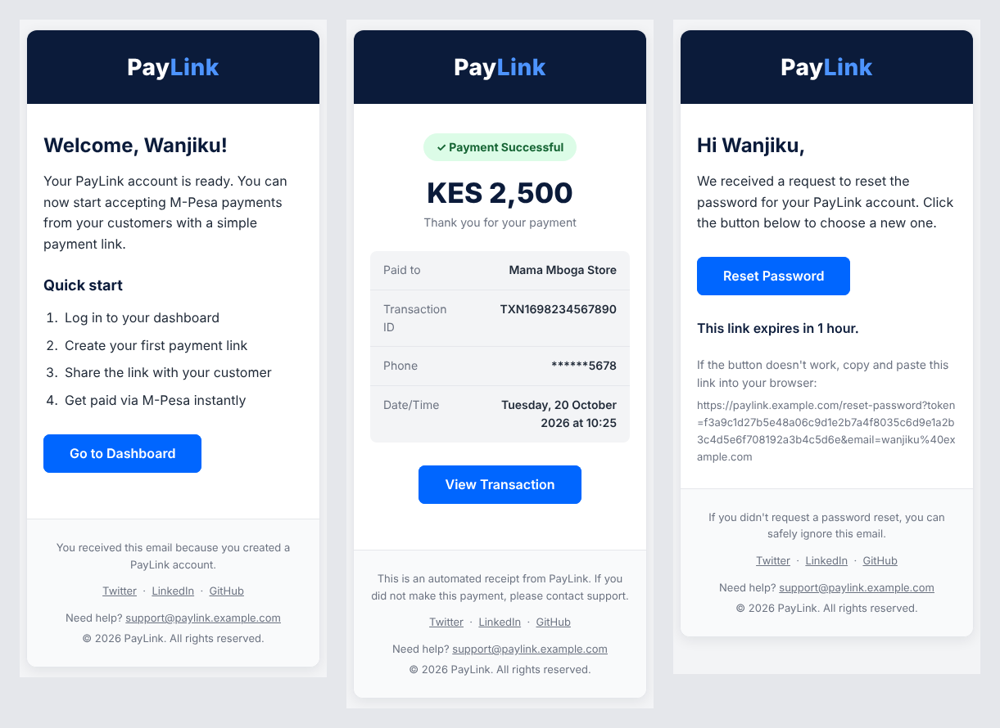

# Email Integration (Week 10 · Day 3)

PayLink transactional emails sent with [Resend](https://resend.com): a **welcome email**, a
**payment receipt** and a **password reset**, all built on a reusable email service with retry,
and a shared, responsive header/footer layout.

## Screenshots

**Welcome email** (`POST /api/register`)



**Payment receipt** (`POST /api/test/payment-receipt`)



**Password reset** (`POST /api/test/password-reset`)



**On a phone** (375px wide): welcome, receipt, password reset



## Setup

```bash
npm install
cp .env.example .env     # then put your real Resend API key in .env
node server.js           # or: npm start / npm run dev (auto-restart)
```

If `RESEND_API_KEY` is missing the server still starts, prints a warning, and email endpoints
return a clear error instead of crashing.

## Try it

```bash
# Task 1: welcome email (responds immediately; the email is sent in the background)
curl -X POST http://localhost:3001/api/register \
  -H "Content-Type: application/json" \
  -d '{"name": "Wanjiku Kamau", "email": "your-email@gmail.com"}'

# Task 2: payment receipt
curl -X POST http://localhost:3001/api/test/payment-receipt \
  -H "Content-Type: application/json" \
  -d '{"email": "your-email@gmail.com", "amount": 2500, "phone": "0712345678", "merchantName": "Mama Mboga Store"}'

# Task 3: password reset
curl -X POST http://localhost:3001/api/test/password-reset \
  -H "Content-Type: application/json" \
  -d '{"name": "Wanjiku Kamau", "email": "your-email@gmail.com"}'
```

| Endpoint | Success response |
| --- | --- |
| `POST /api/register` | `201 { success: true, message: "Account created. Welcome email sent." }` |
| `POST /api/test/payment-receipt` | `200 { success: true, transactionId: "TXN…", message: "Receipt email sent" }` |
| `POST /api/test/password-reset` | `200 { success: true, message: "Password reset email sent" }` |

Errors use `{ success: false, error }`: **400** for invalid input or malformed JSON, **502** when the
receipt/reset email could not be sent, **404** for unknown routes.

To look at the templates without sending anything, run `npm run preview` and open the files in `previews/`.

## How it works

- **Templates** return `{ html, text }`. The HTML uses nested tables and inline styles for email
  client compatibility; the plain-text version carries the same content with no markup.
- **Email service**: `sendEmail({ to, subject, html, text })` wraps `resend.emails.send()`, logs the
  email ID, and **retries once after 1 second**. If the retry fails too, the error is thrown. It
  handles both ways Resend can fail (a returned `{ error }` and a thrown network error).
  The three convenience functions build their template and call `sendEmail`.
- **Welcome email is fire-and-forget**: `sendWelcomeEmail(...).catch(console.error)` is not awaited,
  so the 201 comes back without waiting for Resend. The receipt and reset endpoints *do* await the
  send, so they can honestly report success or failure.
- **Bonus**: all three emails share one header (dark background, PayLink logo text) and footer
  (copyright, support email, Twitter / LinkedIn / GitHub text links). The container is
  `max-width: 600px; width: 100%` with a border and soft shadow, and a small media query tightens
  padding on phones.

## Testing

```bash
npm test
```

19 tests with a fake Resend client (no API key or network needed): template content and escaping,
phone masking, retry behaviour (fails once, fails twice, thrown vs returned errors), that
`/api/register` responds before a slow provider finishes, validation, and error responses.

## Decisions and small deviations

- **Lazy Resend client.** `new Resend()` throws when the key is missing, so the client is created
  on first send rather than at import time.
- **HTML escaping.** Names and merchant names are escaped in the HTML, so a name like
  `<script>` cannot inject markup into an email.
- **First name** is taken after trimming and splitting on any whitespace, so `"  Ochieng   Otieno"`
  still gives "Ochieng" (a plain `split(' ')[0]` would give an empty greeting).
- **Email validation** requires `text@domain.tld` (the spec's minimum is just an `@`).
- **Amounts** use `toLocaleString('en-US')` so thousands separators are consistent on every machine.

